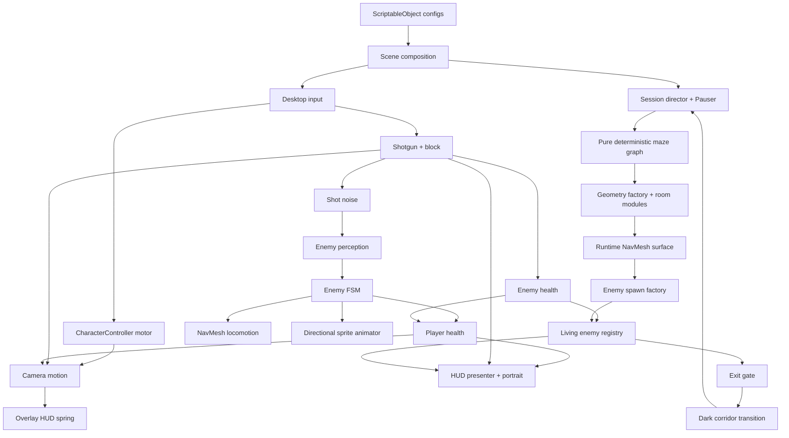

# MAZEHELL: архитектура реализации

Дата: 2026-10-17. Архитектура и контракт сопровождения. Код реализован GLM через Claude Code MCP, проверен и интегрирован основным агентом.

## Источники и приоритеты

Прочитать `Wiki/AI_RULES.md`, `Wiki/ГДД MAZEHELL.md`, текущие `ArtSource/Structures/README.md`, `IMPLEMENTATION.md`, `structures_manifest.json`, `Assets/MazeHell/Resources/Images/README.md`. Wiki восстановлена из локального предыдущего рабочего каталога `/home/otecglinomes/orca/workspaces/MazeHell/dagon/Wiki`: публичная GitHub Wiki сейчас отсутствует. Последнее поручение пользователя выше GDD, текущие ассеты выше устаревших предположений документа. Unity фактически 6000.4.0f1, URP 17.4, Input System 1.19, AI Navigation 2.0.11 уже установлены. Не мигрировать в Built-in несмотря на старую строку GDD. Правила от MadSlime/YG2 не означают существование этих классов здесь: не добавлять чужие namespace, SDK-заглушки или сервис-локаторы. Авторизация, реклама и облачный лидерборд требуют настоящего SDK, не подделывать успешную отправку. RU/EN из GDD обязательны; строки в конфиге локализации. Существующие незакоммиченные ассеты и StructureTestMap сохранять.

## Результат

Две сохранённые сцены Menu и Game, настроенные SO-конфиги, Player/HUD/Imp/HealingOrb prefabs, играбельный непрерывный забег: старт → генерация → бой → последний враг → открытие врат → физический тёмный проход → следующий уровень → смерть → результат/повтор. Никакого ручного поиска объектов, hidden bootstrap, singletons, глобальных mutable static, generic event bus. Единственная точка сборки графа зависимостей на сцену. Вся настройка баланса, света, камеры, HUD, анимации, размещения и перехода — через SO-ассеты с дизайнерскими полями, без чисел баланса в поведении.

## Навигация: Unity runtime NavMesh

Решение автора архитектуры: NavMeshSurface собирается после построения уровня и закрытия неиспользованных дверных проёмов, перед спавном агентов. Используется уже установленный AI Navigation, не сторонний A* пакет. Причина: граф коридоров прост, но существующие 40×40 комнаты имеют колонны и внутренние подкомнаты; A* только по клеткам не обходит локальные препятствия. Граф генерации и NavMesh разделены: граф доказывает связность, определяет петли/тупики/дальнюю пару; NavMesh определяет реальную проходимость и движение. Не смешивать сетку логических клеток с реальными единицами.

Surface собирает только Geometry root и физические collider-источники. Игрок, враги, трупы, UI и пикапы исключены. NavMeshAgent radius/height согласован с bake-параметрами, spawning через SamplePosition и проверку полного пути до входа. Ограниченная частота SetDestination из конфига, никаких destination каждый кадр на 40 врагах. Корпуса агентов крутятся по пути, billboard крутится отдельно; зрение всегда смотрит вдоль корпуса, не спрайта. Погибшие агенты отключены, не блокируют навигацию. Ворота заперты физическим коллайдером; точка перехода за воротами и отдельно проверяет зачистку. Подвижный leaf выходных ворот находится вне Geometry и не запекается как постоянная стена. Статические дверные проёмы модулей открыты; неиспользованные порты закрыты.

## Папки и зависимости

`Assets/MazeHell/Scripts/{ScriptableObjects,Input,Player,Combat,Enemies,Level,Presentation,UI,Audio,Session}` с namespace по модулю. Каждый класс — отдельный файл. Данные конфигов не содержат gameplay-методов. Простые MonoBehaviour и C#-классы через Setup/конструктор. Использовать существующую структуру проекта, не вводить контейнер DI.

Поток: SceneComposition → данные/фабрики → компоненты → явные C# события → presentation. Input не пишет UI. HUD не пишет камеру. Enemy не ищет Player. Health не открывает дверь. Generation не спавнит игрока сама. RunSession владеет стадиями RunState, текущим LevelRoot и временем; Pauser единственный писатель Time.timeScale, обрабатывает Esc и потерю фокуса. Start/Restart явно сбрасывают состояние, освобождают курсор при смерти/меню, подписки симметрично снимаются.

## Конфиги

- PlayerMovementConfig: baseSpeed 7, acceleration/friction, airAcceleration и airWishSpeed, gravity/jumpHeight ~1, jumpBuffer/coyote/bhopGrace ~0.15, softSpeedCap ~12, capDecay, dash multiplier 3/duration .18/cooldown 1.5/invulnerability .2, groundedProbe/skin и knockback decay, block speed .6.
- PlayerCombatConfig: maxHealth100, block damage .3, block cooldown2, knockback1.5, stun.6; без неподтверждённого perfect-block.
- ShotgunConfig: pelletCount8, pelletDamage2.5, spread/range, minimumInterval .12, volleyWindow .25, reload .6, animation durations, noise radius25, muzzle flash intensity/time и enemy knockback. Отдача целиком настраивается в CameraMotionConfig.
- EnemyConfig: hp30/cap50/+2, speed6.2/+1.5% cap25%, damage15–18, visionRange12/FOV90/hearing25, search wait/lose sight grace/return tolerance, perception/path cadence, attack range2.5/windup .38/protected final .15/lunge distance3.5/duration/cooldown .9, healOnKill10, flinch/stun, colliders/agent settings.
- LevelGenerationConfig: seed, logical side16/+2/cap36, physical cell size и размеры модульной раскладки отдельно, два внешних авторских зала, loop budget, minimum deadends, wall thickness/ceiling, enemy8/+3/cap40, heal count25 HP, spacing/safe spawn distances, module catalog и materials.
- LevelPresentationConfig: fog, lighting/caps, module/door references, open lift height/speed, exit glow, dark corridor10–15 sec при базовой скорости (длина задаётся согласованно), splash/fade durations.
- CameraMotionConfig: sensitivity/pitch limits/FOV и speed FOV, headbob amplitudes/frequency, jump/land/dash/hit/shot/block impulses, critically damped return. Ограничители суммарного смещения/вращения.
- HudMotionConfig: spring frequency/damping, angular/position camera-to-screen gain, maximum pixel displacement/angle, overscan margin, separate weapon gain, face durations/health bands. Никакого независимого random shake HUD.
- AnimationLibrary/VisualConfig: Sprite arrays для front/side/back walk, windup/lunge/pain/corpse, оружия idle/single/volley/reload/empty/block, лица healthy/scratched/bleeding/critical/neardeath/hit; интервалы кадров и world size.
- InterfaceConfig/LocalizationConfig/AudioConfig: все строки RU/EN, ссылки на font/sprites, scale/layout/colors, громкость/чувствительность пользовательских настроек и аудиоклипы/микшер/пулы.

Конфиги валидируются на входе Setup и ограничениями инспектора. Нулевые durations, пустые обязательные ссылки, несовместимые размеры дают понятную ошибку, а не случайный NullRef. Runtime не мутирует SO: масштабирование уровня в отдельную session data.

## Игрок

DesktopInput читает новый Input System (WASD, mouse, Space, Shift, ЛКМ, ПКМ, Esc), выдаёт снимок. Cursor lock по пользовательскому старту. PlayerMotor — единственный писатель CharacterController.Move и velocity. PlayerLook — yaw корня и pitch pivot; CameraMotion — единственный писатель локального transform камеры поверх LookPivot. Один упорядоченный Update: input → look → motor → combat; LateUpdate камера, затем HUD.

Motor: горизонтальный вектор и вертикальная скорость, ground friction пропускается в bhop grace, буфер нажатия Space ловит спам перед касанием, удерживание не превращать в бесконечный автопрыжок. Source air accelerate ограничивает проекцию на wish direction, мягкий кап постепенно гасит превышение. Прыжок из sqrt(2*g*height); CC collision flags убирают вертикальную скорость в потолке и не дают проходить стены. Dash берёт направление движения либо взгляд, отдельно таймер/неуязвимость, скорость не складывается бесконечно с каждого запроса. Блок замедляет, успешный блок через PlayerDefense снижает урон, стартует КД, импульс игроку и стан врагу. На КД можно держать позу, но защиты нет. Health clamps 0..max, событие death ровно один раз, лечение за подтверждённое убийство, не за каждую дробину.

## Оружие

Shotgun — явные состояния Ready/Reloading/Blocking, 2 заряда, только click edges. Первая дробь наносит 20 сразу; второй клик в окне .25 тратит оставшийся ствол и завершает залп суммарно 40, усиливает отдачу/отброс, не создаёт бесплатные дополнительные 40. За окном второй клик обычный. Минимальный интервал .12, пустые стволы запускают .6 reload из двух фаз. ПКМ запрещает огонь. Raycast каждой дробины от камеры с ближайшим блокирующим collider; стены останавливают дробь, enemy collider resolves explicit damage component. Шум публикуется только при реальном выстреле, одна позиция для AI; шаги, прыжок, урон и reload не привлекают врагов. Мгновенный kill не учитывается дважды несколькими pellets.

## AI и анимация

EnemyBrain FSM Idle/Investigating/Searching/Chasing/Windup/Lunging/Recovering/Stunned/Returning/Dead. EnemyPerception принимает прямые ссылки на цель и ShotNoise, проверяет дальность/FOV/Physics.Raycast по occlusion mask. При выстреле в hearing radius запоминает точку, идёт к ней; по прибытии ждёт searchDuration; без контакта идёт домой в исходную позицию/rotation. В Chase обновляет lastSeen только при истинном зрении. Потерял зрение → идёт к lastSeen, ждёт, возвращается. Игрок за стеной не отслеживается по его реальной текущей позиции. Новое зрение перехватывает investigate/return. Новые выстрелы могут перенаправить поиск, но не отменяют активный выпад/стан. Windup телеграфирует .38, финальные .15 защищены от flinch. Lunge в зафиксированном направлении с проверкой коллизии и одним damage за атаку; рывок игрока даёт invulnerability. Block сообщает stun атакующему. Dead выключает урон/collider/agent, registry удаляет один раз.

EnemyLocomotion только NavMeshAgent и поворот корпуса. EnemySpriteAnimator принимает State/velocity и угол между forward корпуса и camera: front/side/back; opposite side через flipX, без подмены rear на front. Биллборд только по yaw, упор на foot pivot и сохранение масштаба. Труп лежит на полу и остаётся до выгрузки уровня. Уровень владеет всеми трупами, не DontDestroyOnLoad.

## Генерация и геометрия

Генератор чистых данных с System.Random(seed), не глобальный UnityEngine.Random для воспроизводимости. Orthogonal connected graph, DFS spanning tree + ограниченное добавление loop edges, сохранение некоторого числа тупиков. Генератор выбирает удалённую пару по графу; GeometryFactory дополнительно перебирает западные и восточные граничные клетки и выбирает максимальную дистанцию между допустимыми портами. Враги/хилы только на достижимых позициях; старт безопасен, не в комнате с выпадающим в упор бесом.

Использовать авторские module prefabs в раскладке там, где их реальные размеры и проёмы совпадают. Нельзя просто ставить 41 м комнаты на сетку 4 м. Один допустимый подход: растровая сетка проходов+арен, арены вырезают объём и существующий модуль ставится в подготовленный прямоугольник; второй: macro sockets с 41 м main rooms и 24 м corridors, mini rooms компенсируются прямыми секциями. Все неиспользованные боковые проёмы закрываются геометрией. Проходы без диагоналей/кривых, collider соответствует видимой стене, не создавать гигантскую карту 16×16 комнат по 40 м. Между generation side16 и макромодулями нужна явная связь (16 малых cells, часть объединена в арены). Минимум один зал с колоннами на старте; прямые полосы для бхопа. Коллизии floor/wall/door; roof корректной высоты.

GeneratedLevel содержит spawn/exit/graph/enemy spawns/pickups/NavMeshSurface. LevelGeometryBuilder создаёт tiled meshes, LevelGeometryFactory собирает root, NavMesh, точки; EnemyFactory создаёт настроенных врагов. LevelResources освобождает принадлежащие уровню meshes и NavMeshData. Не плодить по кубу на каждый грань без bounds/culling; целевой лимит draw calls и света. Существующие материалы с URP normal maps использовать.

EnemyRegistry единственный источник livingCount. ExitGate подписан на CountChanged; zero после завершения всех spawn, без временного открытия во время регистрации. Поднять leaf, glow/horn один раз, trigger за leaf проверяет run stage и count0. Transition проход физически доступен, покрыт полом/стенами и плавно темнеет; длительность/длина согласованы. Следующий seed/сложность готовятся пока идёт игрок, старый уровень очищается контролируемо, повторный trigger игнорируется.

## Камера и пружина HUD

Иерархия PlayerRoot → LookPivot(pitch) → MotionPivot(bob/impulses/roll) → Camera. MotionState/CameraMotion содержит итоговые сглаженные offsets, angular velocity и линейную реакцию на motor/combat. Каждое действие (ходьба, hit, dash, jump, land, shot, block) воздействует на камеру через конфигурируемый импульс. Headbob зависит от фактической horizontal speed и grounded, не от удерживания W в стену. Удары ограничены и затухают; additive impulses не взрываются при спаме. TimeScale0 замораживает gameplay, UI паузы остаётся кликабельным.

Canvas строго Screen Space Overlay, CanvasScaler ScaleWithScreenSize1920×1080/match.5, SafeArea parent → SpringRoot HUD/weapon. HudSpring следует измеренным motion offsets камеры с запаздыванием spring-damper, а не подписывается на те же шесть действий и трясёт всё заново. Стабильная интеграция (аналитическая damped spring либо bounded substep dt), pixel/roll clamp; input raw yaw не переносится как абсолютные 360°. Прицел сохраняет читаемость (small gain), рамки здоровья у safe edges, spring margin не даёт лицу уйти за экран. Оружие отдельный дочерний spring response, но тот же источник камеры. Damage vignette/face смена визуального состояния отдельно от движения spring.

HudPresenter health/face/ammo/dash/aliveCount только читает модели и события. Face health tiers с loop4frames и отдельными длительностями кадров из AnimationLibrary (обычные .75/.35/.12/.50, hit .07/.09/.08/.10) и temporary hit override; hit возвращается в актуальное health состояние, не в захваченный старый sprite. Weapon animation priority block/fire/reload/idle. Dash pip показывает фактический cooldown. Мёртвый игрок не стреляет/не двигается.

## Меню, звук, сохранения

Menu composition подключает готовый фон без повторно запечённых надписей, overlay текста локализован, кликабельные TMP кнопки Start/Record/Language/Sound/Quit там где применимо. Pause Resume/Restart/Sound/Sensitivity/Menu. Death Level/Kills/Time/Best, Retry/Menu. Best хранится локально в отдельном RecordStorage, лидерборд без SDK честно сообщает недоступность и позволяет повторить. Не использовать голый UnityEvent для игровых подписок; кнопки можно обрабатывать компонентом IPointerClickHandler с C# событием. EventSystem и InputSystemUIInputModule обязательны.

Audio начинается по клику Start. Настоящие доступные клипы; при отсутствии создать процедурные авторские WAV, не молчаливые fake hooks. Один music source, ограниченный пул SFX. Heartbeat по здоровью/переходу, footsteps по пройденному пути, gun/reload/telegraph/lunge/pain/death/gate/UI. Из config, не AudioClip.Create на каждом выстреле. App focus loss пауза и тишина, resume по явному действию.

## Ресурсы и интеграция

Существуют front walk2/windup/lunge/pain/corpse, shotgun6 состояний без block, face6×4, HUD icons, menu background, heal_orb.fbx, fontPressStart2P. Side/back ходьба и block сгенерированы и добавлены; исходные front-спрайты сохранены. Нужны configuration sprite arrays и реальные prefabs, не только Resources.Load в Update. Убрать запечённые тексты фона из интерактивных зон, если они есть.

## Проверка и критерии

Unity batchmode compile0errors. EditMode meaningful tests: разные seeds connected/loops/deadends/entry-exit reachability; health death once/heal cap; weaponammo/volley/reload; AI lastSeen/wait/return; spring finite/clamped при dt spike. PlayMode smoke: сцена MenuStart, созданный player/HUD/enemies/geometry, NavMesh complete path до spawn enemies, закрытый exit count>0/открытый zero, no missing scripts/no exceptions, restart cleans subscriptions/timeScale, несколько seeds/следующий уровень. Не писать отдельные editor-инструменты настройки/аудита (Wiki запрещает без запроса); временный disposable batch assembly script допустим для прямого поручения собрать сцены, убрать после сохранения артефактов. Главный агент проверяет код GLM до сборки сцен. Отчёт о фактически пройденных проверках без заявления о WebGL публикации/SDK интеграции, если их не было.

## MCP → Claude Code → GLM

`Tools/ClaudeCodeMcp/server.py` — настоящий stdio MCP на официальном Python SDK, requirements закреплены на mcp1.30.0. Codex зарегистрирован через `codex mcp add claude-code-glm`; локальный `.mcp.json` также содержит подключение. API:

- `claude_code_start(prompt, effort="high", model="glm-5.3-flash[1M]", resume_session="")`: возвращает job_id немедленно; создаёт отдельный процесс Claude Code CLI в корне MazeHell, разрешает явно Read/Write/Edit/Glob/Grep/Bash, не подключает вложенные MCP и не вызывает GLM API напрямую. CLI получает high effort и MAX_THINKING_TOKENS=8192 по умолчанию (существующая переменная окружения сохраняется); конкретный провайдер определяет поддержку лимита. Большая реализация передаётся последовательными частями с сохранением сессии.
- `claude_code_status(job_id,max_chars)`: состояние, session_id, последние тексты и имена инструментов, код выхода/ошибка. Перезапуск MCP не убивает задания: данные лежат в исключённом из Git Library/ClaudeCodeMcp.
- `claude_code_cancel(job_id)`: завершает process group агента, сохраняет историю. Для продолжения после завершения/остановки вызвать start с его session_id. Не запускать два writer одного session_id одновременно.

Текущий клиент Codex загрузил tools MCP без перезапуска чата. Одиннадцать автоматических тестов проверяют транспорт stdio/list_tools/call_tool, обработку ошибок, сохранение буквального prompt без shell-интерполяции, отмену/валидацию и чтение ответа. Команда: `Tools/ClaudeCodeMcp/.venv/bin/python -m unittest discover -s Tools/ClaudeCodeMcp -p 'test_*.py' -v`. При восстановлении окружения: `uv venv Tools/ClaudeCodeMcp/.venv`, затем `uv pip install --python Tools/ClaudeCodeMcp/.venv/bin/python -r Tools/ClaudeCodeMcp/requirements.txt`.

## Поток зависимостей

Стрелка означает передачу данных/зависимости или событие, не глобальную подписку. Только composition связывает ссылки. Registry получает все регистрации до FinishSpawning. Ни Gate, ни HUD не считают FindObjectsOfType и не опрашивают сцену. RunSession деактивирует и удаляет весь LevelRoot при переходе; наблюдатели отписываются до уничтожения.

## Фактическая сборка и владение

`Assets/MazeHell/Scenes/Menu.unity` — первая сцена Build Settings. UI сцены — экземпляр `Assets/MazeHell/Resources/Prefabs/UI/MainMenu.prefab`. `MenuComposition` получает MenuView и конфиги, на первом клике запускает звук, меняет язык/громкость и открывает Game. `Assets/MazeHell/Scenes/Game.unity` содержит GameRoot (GameComposition, DesktopInput, Pauser, music source, 16 SFX sources), World и EventSystem. Точные serialized-поля: `GLM_ASSEMBLY.md`. Демонстрационная StructureTestMap сохранена и исключена из игрового билда.

GameComposition создаёт ShotNoise и фабрики, затем Player, HUD, RunSession и GameLoop. PlayerFactory связывает здоровье/мотор/обзор/дробовик/защиту/камеру, добавляет MuzzleFlash и PlayerFeedback; они вызываются явно из GameLoop для вспышки и шагов после моторики и стрельбы. GameLoop вызывает look→motor→defense→shotgun→AI; LateUpdate вызывает camera→HUD. HudFactory настраивает SafeArea, создаёт HudPresenter и HudScreens на подготовленном HUD. Фабрики — единственное место Instantiate gameplay prefab. Шум — экземпляр на сцену, не глобальный автобус.

RunSession владеет EnemyRegistry, текущим GeneratedLevel и следующей MazeLayout. Во время тёмного прохода заранее рассчитывается и сохраняется следующий граф; геометрия и NavMesh создаются после гарантированного чёрного кадра. Старый root сначала деактивируется, RemoveData удаляет NavMesh, затем Destroy освобождает объекты; LevelResources удаляет созданные meshes. Игрок переносится после события PlayerLevelStart с синхронизацией yaw/pitch и сбросом камеры/пружины. HP сохраняется. Смерть сохраняет рекорд, ставит Pauser и открывает Death; Retry/Menu снимают паузу перед загрузкой сцены. Dispose снимает подписки Registry.

Физическая раскладка: сетка 16×16 клеток по 4 м; room_quarters слева и room_gate справа, соединители по 24 м. Авторские комнаты около 40 м, не масштабируются под клетку. Все проёмы согласованы по осям X/Z. Первые два врага размещаются в залах, остальные — на достижимых точках сетки. Тёмный проход за восточным выходом длиной 84 м. Конец перехода расположен перед физической конечной стеной; ввод заблокирован на стадии Generating. До зачистки переход недоступен и физически, и по состоянию сессии.

Префабы: `Assets/MazeHell/Resources/Prefabs/{Player/Player,Enemies/Imp,UI/HUD,Collectables/HealingOrb}.prefab`. Профили: `Assets/MazeHell/Scriptables/`. HealOrb использует исходную FBX-модель и отдельные URP-материалы. Runtime sprites импортированы как Sprite/FullRect/Point, а не GUI textures. Billboard — отдельный URP cutout shader, UI vignette — отдельный UI shader. Звук — 20 настоящих PCM WAV; происхождение сгенерированных изображений — Tools/Art/gameplay_sources.json.

Лидерборд Яндекса честно сообщает об отсутствии подключения: SDK в исходном проекте отсутствует. Локальный рекорд, RU/EN и звук работают независимо. Сетевая авторизация, реклама и публикация на Яндекс Играх в эту локальную сборку не подменены заглушкой.

## Проверенный запуск

Запуск из Unity: открыть Menu и нажать Play. Сцены и префабы уже сохранены; повторный запуск удалённых disposable authoring scripts не требуется. Для локальной WebGL-проверки: `python3 -m http.server 8765 --bind 127.0.0.1 --directory Builds/WebGL`, открыть `http://127.0.0.1:8765/`. Шаблон `Assets/WebGLTemplates/MazeHell` заполняет окно, показывает прогресс загрузки и обрабатывает отказ браузера в pointer lock без аварийного alert. Такой отказ не подменяется успешным захватом: во встроенных webview обзор мышью может быть ограничен, обычный браузер остаётся целевой средой.

Проверки: 45 EditMode, 10 PlayMode и 11 Python MCP tests. PlayMode включает настоящий bake модульной геометрии и полный путь до всех врагов/конца прохода, восприятие шума/стены/однократный удар, прыжок/бхоп/деш, меню RU/EN/звук и полный переход уровень1→2→смерть. Наборы результатов находятся в `Library/all-edit-tests.xml` и `Library/all-play-tests.xml`; логи и артефакты Library не коммитятся. WebGL компилируется штатным Unity BuildPipeline; сборка находится в Builds/WebGL. SDK Яндекса и публикация не проверялись и не заявляются.
